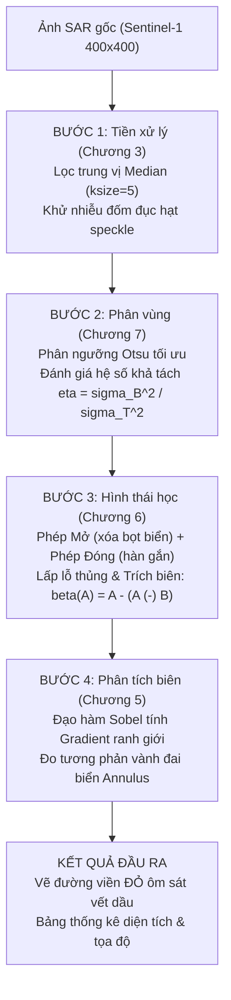

# HỆ THỐNG PHÁT HIỆN VẾT DẦU TRÀN TRÊN BIỂN TỪ ẢNH SAR SENTINEL-1
## BÀI TẬP LỚN MÔN XỬ LÝ ẢNH / COMPUTER VISION — ĐẠI HỌC GIAO THÔNG VẬN TẢI (UTC)
**Học phần:** Xử lý ảnh | **Chuẩn đầu ra:** CDIO Toàn diện (50% điểm học phần)  
**Giảng viên hướng dẫn:** TS. Phan Thanh Toàn  
**Đề tài số 18:** Phát hiện vết dầu tràn trên biển từ ảnh SAR (★★★) — NASA #6  
**Ứng dụng thực tiễn:** Giám sát môi trường biển, cảnh báo sớm dầu vón cục và tràn dầu trôi dạt bờ biển miền Trung Việt Nam

---

## 1. GIỚI THIỆU BÀI TOÁN & Ý NGHĨA THỰC TIỄN
Hàng năm, vùng biển và dải bờ biển các tỉnh miền Trung (Hà Tĩnh, Quảng Bình, Quảng Trị, Thừa Thiên Huế, Đà Nẵng, Quảng Nam, Quảng Ngãi...) thường xuyên đối mặt với sự cố dầu vón cục và các vệt dầu trôi dạt vào bờ, đe dọa nghiêm trọng hệ sinh thái biển, khu bảo tồn san hô, nghề cá và ngành du lịch ven biển.

Việc giám sát bằng ảnh vệ tinh quang học truyền thống bị giới hạn lớn bởi mây mù và bóng tối. Công nghệ **Radar khẩu độ tổng hợp (SAR)** từ vệ tinh Sentinel-1 có khả năng chụp xuyên mây, hoạt động 24/7 cả ngày lẫn đêm, là giải pháp tối ưu để phát hiện sớm các vệt dầu loang ngoài khơi.

Dự án này nghiên cứu và hiện thực hóa hệ thống phát hiện vết dầu tràn tự động bằng **100% thuật toán Xử lý ảnh (Computer Vision) thuần túy**, tự cài đặt mã nguồn bằng thư viện **NumPy**, tuân thủ nghiêm ngặt giáo trình bài giảng của TS. Phan Thanh Toàn.

---

## 2. BẢNG PHÂN CÔNG 5 VAI TRÒ CHUẨN CDIO

| Vai trò | Thành viên | Trách nhiệm chính trong mã nguồn | Phần viết trong Báo cáo |
| :---: | :--- | :--- | :--- |
| **TV1** | *Trưởng nhóm, Tích hợp (PM)* | Quản lý tiến độ, Git repo, thiết kế kiến trúc mã, làm Web App Demo tương tác (Streamlit). | **Chương 1**, **Mục 3.1 & 3.4**, **Chương 5** |
| **TV2** | *Lý thuyết, Kiểm chứng* | Dẫn xuất công thức toán, ví dụ tính tay $5 \times 5$, code kiểm chứng so sánh NumPy vs OpenCV. | **Chương 2**, **Mục 3.5** |
| **TV3** | *Cài đặt thuật toán 1* | Tự lập trình bằng NumPy: Lọc trung vị khử nhiễu đốm speckle, phân ngưỡng Otsu tối ưu tính hệ số $\eta$. | **Mục 3.2** |
| **TV4** | *Cài đặt thuật toán 2* | Tự lập trình bằng NumPy: Hình thái học (co, dãn, mở, đóng), trích biên $\beta(A)$, trích 4 đặc trưng phân biệt. | **Mục 3.3** |
| **TV5** | *Dữ liệu, Thực nghiệm* | Quản lý 5,630 ảnh SAR, viết script chạy thực nghiệm tự động, đo Precision/Recall/F1, vẽ ma trận nhầm lẫn. | **Chương 4** |

---

## 3. CẨM NANG DÀNH CHO NHÓM TRONG THƯ MỤC `docs/`

Toàn bộ tài liệu quy chuẩn và kế hoạch điều hành của Project Manager (TV1) được lưu trữ chi tiết:

- 📑 [`docs/00_TONG_QUAN_VA_CHI_THI_PM.md`](file:///D:/Codin/utc-code/HK4_1/XLA/BTL/docs/00_TONG_QUAN_VA_CHI_THI_PM.md): Tổng quan chiến lược, checklist từng giai đoạn và lời khuyên đạt điểm A+.
- 📅 [`docs/01_KE_HOACH_3_TUAN_PM_ROADMAP.md`](file:///D:/Codin/utc-code/HK4_1/XLA/BTL/docs/01_KE_HOACH_3_TUAN_PM_ROADMAP.md): Lộ trình 3 tuần (21 ngày) chi tiết theo ngày (Agile Scrum rút gọn), tiêu chí nghiệm thu (DoD), quản trị rủi ro.
- 👥 [`docs/02_PHAN_CONG_NHIEM_VU_5_THANH_VIEN.md`](file:///D:/Codin/utc-code/HK4_1/XLA/BTL/docs/02_PHAN_CONG_NHIEM_VU_5_THANH_VIEN.md): Ma trận phân công chi tiết công việc, chiến lược đào tạo chéo và biểu mẫu đánh giá thành viên.
- 🌿 [`docs/03_GIT_WORKFLOW_VA_QUY_CHUAN_CODE.md`](file:///D:/Codin/utc-code/HK4_1/XLA/BTL/docs/03_GIT_WORKFLOW_VA_QUY_CHUAN_CODE.md): Chiến lược phân nhánh Git Flow, chuẩn Conventional Commits và tiêu chuẩn code NumPy thuần không dùng hộp đen thư viện.
- 📖 [`docs/04_DE_CUONG_BAO_CAO_30_60_TRANG.md`](file:///D:/Codin/utc-code/HK4_1/XLA/BTL/docs/04_DE_CUONG_BAO_CAO_30_60_TRANG.md): Khung đề cương báo cáo kỹ thuật 5 chương (45-55 trang) chuẩn CDIO, phân bổ số trang và hướng dẫn trình bày.
- 🎤 [`docs/05_KE_HOACH_DEMO_SLIDE_VIDEO_VAN_DAP.md`](file:///D:/Codin/utc-code/HK4_1/XLA/BTL/docs/05_KE_HOACH_DEMO_SLIDE_VIDEO_VAN_DAP.md): Thiết kế ứng dụng demo Streamlit, kịch bản video demo 6 phút, cấu trúc 18 slide thuyết trình và ngân hàng 15 câu hỏi vấn đáp cốt lõi kèm đáp án mẫu.

---

## 4. QUY TRÌNH 4 BƯỚC XỬ LÝ ẢNH THEO GIÁO TRÌNH TS. PHAN THANH TOÀN



---

## 5. CẤU TRÚC THƯ MỤC DỰ ÁN

```
BTL/
├── docs/                                  # HỆ THỐNG TÀI LIỆU QUẢN TRỊ DỰ ÁN CỦA PM
│   ├── 00_TONG_QUAN_VA_CHI_THI_PM.md
│   ├── 01_KE_HOACH_3_TUAN_PM_ROADMAP.md
│   ├── 02_PHAN_CONG_NHIEM_VU_5_THANH_VIEN.md
│   ├── 03_GIT_WORKFLOW_VA_QUY_CHUAN_CODE.md
│   ├── 04_DE_CUONG_BAO_CAO_30_60_TRANG.md
│   └── 05_KE_HOACH_DEMO_SLIDE_VIDEO_VAN_DAP.md
│
├── course_cv/                             # THUẬT TOÁN CHUẨN GIÁO TRÌNH TS. PHAN THANH TOÀN
│   ├── step1_filter.py                    # Chương 3: Lọc trung vị khử nhiễu speckle
│   ├── step2_segmentation.py              # Chương 7: Phân ngưỡng Otsu tối ưu & tính eta
│   ├── step3_morphology.py                # Chương 6: Hình thái học & Trích biên beta(A)
│   ├── step4_edge_gradient.py             # Chương 5: Đạo hàm biên Sobel & Tương phản
│   ├── pipeline.py                        # Pipeline 4 bước khép kín
│   ├── main.py                            # Thực thi batch trên tập ảnh
│   └── matlab_slide_pipeline.m            # Script MATLAB Image Processing Toolbox
│
├── data/                                  # DỮ LIỆU SAR SENTINEL-1 (CSIRO DATASET)
│   ├── Class_0/                           # 3,725 ảnh không chứa dầu (Look-alikes)
│   ├── Class_1/                           # 1,905 ảnh có chứa vết dầu tràn thực tế
│   └── sample/                            # Ảnh mẫu kiểm thử nhanh
│
├── outputs_slide/                         # ẢNH KẾT QUẢ TRỰC QUAN VIỀN ĐỎ
├── AGENTS.md                              # Chỉ thị dành cho AI Coding Assistant
└── README.md                              # Tài liệu giới thiệu dự án (file này)
```

---

## 6. HƯỚNG DẪN CÀI ĐẶT & THỰC THI NHANH

### 6.1. Cài đặt môi trường
Khuyến nghị sử dụng Python 3.10 trở lên:
```bash
pip install numpy opencv-python scipy scikit-image matplotlib streamlit
```

### 6.2. Chạy pipeline xử lý trên tập ảnh mẫu
```bash
python course_cv/main.py --input_dir data/sample --output_dir outputs_slide
```

### 6.3. Khởi chạy Ứng dụng Giao diện Web Streamlit (Demo tương tác)
```bash
streamlit run app.py
```
*(Nếu chưa có file `app.py`, TV1 sẽ triển khai theo thiết kế trong `docs/05`)*.
