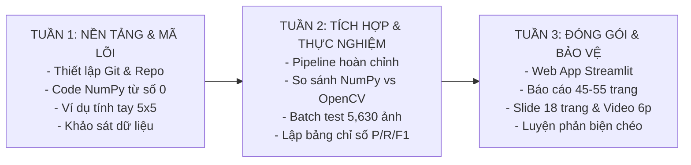

# CẨM NANG TOÀN DIỆN DÀNH CHO PROJECT MANAGER (PM / TRƯỞNG NHÓM)
## BÀI TẬP LỚN XỬ LÝ ẢNH — ĐẠI HỌC GIAO THÔNG VẬN TẢI (UTC)
**Đề tài 18:** Phát hiện vết dầu tràn trên biển từ ảnh SAR (★★★) — NASA #6  
**Giảng viên hướng dẫn:** TS. Phan Thanh Toàn  
**Thời gian thực hiện:** 3 tuần (21 ngày) | **Quy mô:** Nhóm 5 sinh viên  
**Trọng số:** 50% điểm học phần (Chuẩn đầu ra CDIO)

---

## 1. BẢN ĐỒ CHIẾN LƯỢC CỦA PROJECT MANAGER (TV1)

Chào bạn, với vai trò là **Project Manager (TV1 - Trưởng nhóm, Tích hợp hệ thống)**, bạn là "nhạc trưởng" quyết định trực tiếp đến điểm số tối đa (A/A+) của cả nhóm 5 người. 

Trách nhiệm của bạn không chỉ là làm phần việc cá nhân mà là **điều phối, kiểm soát chất lượng, kiến trúc mã nguồn, và đảm bảo mọi thành viên đều vượt qua vòng vấn đáp gắt gao của giảng viên**.

### 1.1. Sứ mệnh cốt lõi của PM
1. **Thiết lập chuẩn mực ngay từ Ngày 1**: Quy định rõ ràng cấu trúc Git, quy tắc commit, tiêu chuẩn code NumPy thuần không dùng hàm đen thư viện cho thuật toán lõi.
2. **Kiểm soát tiến độ theo ngày (Daily Sprint)**: Không để xảy ra tình trạng "nước đến chân mới nhảy" vào tuần 3.
3. **Phụ trách phần việc kỹ thuật trọng tâm**:
   - Thiết kế kiến trúc Pipeline tổng thể (Mục 3.1).
   - Xây dựng Ứng dụng Demo có giao diện trực quan hoàn chỉnh (Streamlit/PyQt) (Mục 3.4).
   - Viết Chương 1 (Mở đầu & Tổng quan) và Chương 5 (Kết luận & Hướng phát triển).
4. **Bảo vệ nhóm trước câu hỏi vấn đáp**: Đảm bảo 100% thành viên hiểu sâu mã nguồn của nhau vì **"Giảng viên chỉ định người bất kỳ trả lời câu hỏi về phần của bạn khác"**.

---

## 2. CHECKLIST NHIỆM VỤ THEO TỪNG GIAI ĐOÀN (3 TUẦN)

### 🎯 GIAI ĐOÀN 1: KHỞI ĐỘNG & NỀN TẢNG (TUẦN 1 - NGÀY 1 ĐẾN NGÀY 7)
- [ ] **Ngày 1**: Họp nhóm Kick-off, quán triệt 5 vai trò, phổ biến quy chế CDIO và barem điểm.
- [ ] **Ngày 1**: Khởi tạo Git Repo, cấu hình `.gitignore`, chia nhánh `develop` và 5 nhánh feature.
- [ ] **Ngày 2**: Giao TV5 chuẩn bị cấu trúc dữ liệu (`data/Class_0`, `data/Class_1`, `data/sample`).
- [ ] **Ngày 2-3**: Giao TV2 xây dựng bảng ký hiệu toán học và ma trận tính tay $5 \times 5$ (Toy Example).
- [ ] **Ngày 3-5**: Giao TV3 tự lập trình bằng NumPy: Lọc trung vị, Box filter, Phân ngưỡng Otsu tối ưu tính $\eta$.
- [ ] **Ngày 4-6**: Giao TV4 tự lập trình bằng NumPy: Phép co dãn, Opening, Closing, Fill holes, trích biên $\beta(A)$ và tính 4 đặc trưng hình thái.
- [ ] **Ngày 7**: TV1 (PM) rà soát PR đầu tiên của TV2, TV3, TV4, TV5; kiểm tra commit riêng của từng người.

### 🎯 GIAI ĐOÀN 2: TÍCH HỢP HỆ THỐNG & ĐÁNH GIÁ ĐỊNH LƯỢNG (TUẦN 2 - NGÀY 8 ĐẾN NGÀY 14)
- [ ] **Ngày 8-9**: TV1 ghép nối toàn bộ các hàm NumPy của TV3 và TV4 thành `pipeline.py` hoàn chỉnh.
- [ ] **Ngày 9-10**: Giao TV2 chạy script `verify_correctness.py` so sánh từng bước NumPy với OpenCV (`np.allclose`, sai số cực tiểu $< 10^{-5}$).
- [ ] **Ngày 10-12**: Giao TV5 chạy thử nghiệm hàng loạt trên 3,725 ảnh Class 0 và 1,905 ảnh Class 1, tính toán:
  - Precision, Recall, F1-score, Confusion Matrix.
  - Thời gian xử lý trung bình mỗi ảnh (Latency - ms).
- [ ] **Ngày 13-14**: Họp nhóm giữa kỳ, đánh giá kết quả thực nghiệm, giải quyết các ca phát hiện sai (False Positives do vùng gió lặng / Look-alikes).

### 🎯 GIAI ĐOÀN 3: ĐÓNG GÓI SẢN PHẨM, VIẾT BÁO CÁO & DIỄN TẬP (TUẦN 3 - NGÀY 15 ĐẾN NGÀY 21)
- [ ] **Ngày 15-16**: TV1 xây dựng hoàn thiện Giao diện Demo Streamlit (`app.py`), hỗ trợ tải ảnh tùy ý, kéo thanh trượt tinh chỉnh ngưỡng và xem ảnh 4 bước thời gian thực.
- [ ] **Ngày 16-18**: Ráp toàn bộ các chương báo cáo thành file Word/LaTeX hoàn chỉnh ($40 - 55$ trang), TV1 trực tiếp biên tập Chương 1, 3.1, 3.4, Chương 5 và chuẩn hóa văn phong.
- [ ] **Ngày 18-19**: Thiết kế Slide báo cáo bảo vệ ($15 - 20$ slide), phân bổ 12 phút thuyết trình cho 5 người.
- [ ] **Ngày 19-20**: Quay video demo 5-7 phút (thuyết minh quy trình thuật toán và ứng dụng thực tế).
- [ ] **Ngày 20**: Tổ chức Họp Mock Defense (diễn tập phản biện thử), PM đóng vai Giảng viên phản biện đặt câu hỏi chéo cho 4 thành viên.
- [ ] **Ngày 21**: Lập Bảng đánh giá chéo thành viên (Peer Review Table), đóng gói toàn bộ hồ sơ (PDF Báo cáo, Slide, Video, Source code Git) và sẵn sàng bảo vệ.

---

## 3. BẢNG PHÂN VAI TRÒ & PHẦN BÁO CÁO CỦA 5 THÀNH VIÊN

| Vai trò | Thành viên | Trách nhiệm chính trong mã nguồn | Phần viết trong Báo cáo | File code phụ trách |
| :--- | :--- | :--- | :--- | :--- |
| **TV1** *(Bạn)* | **PM, Tích hợp** | Quản lý tiến độ, Git workflow, thiết kế kiến trúc mã, làm Web App Demo Streamlit. | **Chương 1**, **Mục 3.1 & 3.4**, **Chương 5** | `app.py`, `pipeline.py`, `docs/*` |
| **TV2** | **Lý thuyết, Kiểm chứng** | Dẫn xuất công thức, tính tay ma trận $5 \times 5$, script kiểm chứng tính đúng NumPy vs OpenCV. | **Chương 2**, **Mục 3.5** | `verify_correctness.py`, `numerical_toy_example.py` |
| **TV3** | **Thuật toán 1** | Tự code bằng NumPy: Median filter, Mean filter, Ngưỡng Otsu tối ưu, hệ số khả tách $\eta$. | **Mục 3.2** | `step1_filter_numpy.py`, `step2_otsu_numpy.py` |
| **TV4** | **Thuật toán 2** | Tự code bằng NumPy: Hình thái học (Erode, Dilate, Open, Close, Trích biên), Trích 4 đặc trưng, Bộ lọc heuristic/SVM. | **Mục 3.3** | `step3_morphology_numpy.py`, `step4_features_numpy.py` |
| **TV5** | **Dữ liệu, Thực nghiệm** | Xử lý tập dữ liệu, script batch benchmark, tính Precision/Recall/F1, vẽ ma trận nhầm lẫn và biểu đồ. | **Chương 4** | `benchmark_evaluation.py`, `plot_charts.py` |

---

## 4. HỆ THỐNG CÁC TÀI LIỆU QUẢN TRỊ TRONG THƯ MỤC `docs/`

Để hỗ trợ bạn điều hành nhóm chuyên nghiệp nhất, toàn bộ tài liệu chi tiết đã được biên soạn đầy đủ:

1. 📄 [`01_KE_HOACH_3_TUAN_PM_ROADMAP.md`](file:///D:/Codin/utc-code/HK4_1/XLA/BTL/docs/01_KE_HOACH_3_TUAN_PM_ROADMAP.md): Kế hoạch tác chiến chi tiết từng ngày, tiêu chuẩn hoàn thành (Definition of Done), quản trị rủi ro.
2. 📄 [`02_PHAN_CONG_NHIEM_VU_5_THANH_VIEN.md`](file:///D:/Codin/utc-code/HK4_1/XLA/BTL/docs/02_PHAN_CONG_NHIEM_VU_5_THANH_VIEN.md): Bảng phân công chi tiết công việc cho 5 người, bảng ký hợp đồng trách nhiệm và biểu mẫu chấm điểm đánh giá chéo.
3. 📄 [`03_GIT_WORKFLOW_VA_QUY_CHUAN_CODE.md`](file:///D:/Codin/utc-code/HK4_1/XLA/BTL/docs/03_GIT_WORKFLOW_VA_QUY_CHUAN_CODE.md): Chiến lược phân nhánh Git, chuẩn Conventional Commits (để có lịch sử commit đẹp), quy định code NumPy thuần & đối chiếu OpenCV.
4. 📄 [`04_DE_CUONG_BAO_CAO_30_60_TRANG.md`](file:///D:/Codin/utc-code/HK4_1/XLA/BTL/docs/04_DE_CUONG_BAO_CAO_30_60_TRANG.md): Khung chi tiết báo cáo kỹ thuật 5 chương chuẩn CDIO, phân trang, công thức toán và quy cách trình bày.
5. 📄 [`05_KE_HOACH_DEMO_SLIDE_VIDEO_VAN_DAP.md`](file:///D:/Codin/utc-code/HK4_1/XLA/BTL/docs/05_KE_HOACH_DEMO_SLIDE_VIDEO_VAN_DAP.md): Thiết kế ứng dụng demo Streamlit, kịch bản video demo 5-7 phút, khung slide 18 trang và ngân hàng 15 câu hỏi phản biện của TS. Phan Thanh Toàn kèm câu trả lời mẫu.

---

## 5. LỜI KHUYÊN ĐẮC LỰC DÀNH CHO PM ĐỂ ĐẠT ĐIỂM 10

> [!IMPORTANT]
> 1. **Kiểm tra Commit hằng ngày**: Giảng viên sẽ xem `git log` để kiểm tra từng thành viên có tự code hay không. Tuyệt đối không để một người commit thay cả nhóm.
> 2. **Không dùng Black-box trong thuật toán chính**: Yêu cầu bắt buộc là cài đặt thuật toán cốt lõi bằng **NumPy**. Thư viện OpenCV chỉ được dùng để đọc/ghi ảnh và so sánh kiểm chứng trong file của TV2.
> 3. **Luyện tập vấn đáp chéo**: Dành ít nhất 2 buổi trước ngày bảo vệ để hỏi vặn lẫn nhau. Thầy Phan Thanh Toàn thường hỏi người làm phần A về nguyên lý toán học của phần B.
> 4. **Gắn liền bài toán thực tế biển miền Trung**: Luôn nhấn mạnh ý nghĩa xã hội trong báo cáo và slide: Dầu vón cục gây ô nhiễm bãi biển Đà Nẵng, Quảng Trị, Thừa Thiên Huế; ảnh SAR Sentinel-1 giúp phát hiện xuyên mây ngoài khơi trước khi dầu dạt vào bờ.
