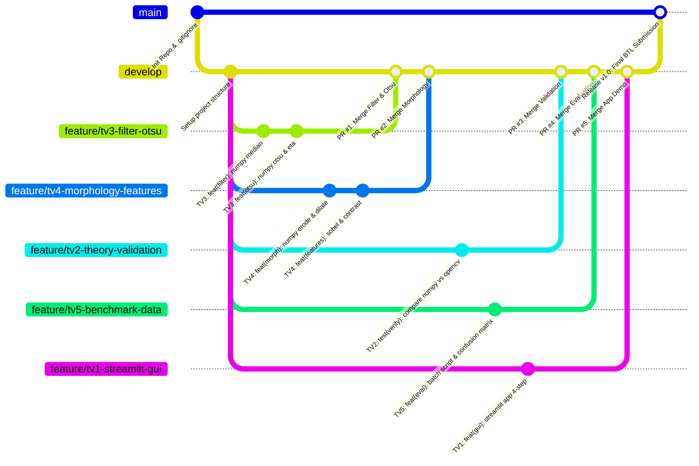

# QUY CHUẨN GIT WORKFLOW & TIÊU CHUẨN LẬP TRÌNH (CODING CONVENTION)
## BÀI TẬP LỚN XỬ LÝ ẢNH — ĐẠI HỌC GIAO THÔNG VẬN TẢI (UTC)
**Đề tài 18:** Phát hiện vết dầu tràn trên biển từ ảnh SAR (★★★) — NASA #6  
**Chủ trì quy chuẩn:** TV1 — Project Manager

---

## 1. NGUYÊN TẮC BẮT BUỘC TỪ ĐỀ CƯƠNG BÀI HỌC

> [!IMPORTANT]
> 1. **Quy định về mã nguồn:**
>    - *"Được dùng thư viện để đọc/ghi ảnh và để đối chiếu, nhưng **thuật toán cốt lõi của đề phải tự cài đặt bằng NumPy**."*
>    - *"Mọi kết quả phải được so sánh với hàm thư viện tương ứng (nếu có) để kiểm chứng tính đúng."*
> 2. **Quy định về Git:**
>    - *"Mỗi thành viên phải có commit riêng trên phần mã mình phụ trách và tham gia phân tích kết quả ở chương 4."*
>    - Giảng viên sẽ kiểm tra `git log` và đồ thị commit đồ họa trên GitHub để đánh giá mức độ đóng góp thực chất của từng sinh viên.

---

## 2. CHIẾN LƯỢC PHÂN NHÁNH GIT (GIT BRANCHING MODEL)

Để đảm bảo không bị xung đột code (conflict) và lịch sử commit của 5 thành viên rõ ràng, nhóm áp dụng mô hình Git Flow rút gọn:



### 2.1. Quy định các nhánh:
1. `main`: Nhánh chính thức, chỉ chứa phiên bản ổn định hoàn hảo cuối cùng nộp cho thầy. Không ai được commit trực tiếp vào `main`.
2. `develop`: Nhánh tích hợp mã nguồn chung của nhóm. Tất cả các tính năng sau khi được TV1 duyệt sẽ được gộp vào đây.
3. Các nhánh Feature cá nhân:
   - `feature/tv1-streamlit-gui`: Dành riêng cho TV1 (App Streamlit, pipeline tích hợp).
   - `feature/tv2-theory-validation`: Dành riêng cho TV2 (Script kiểm chứng NumPy vs OpenCV).
   - `feature/tv3-filter-otsu`: Dành riêng cho TV3 (Lọc trung vị, box filter, ngưỡng Otsu NumPy).
   - `feature/tv4-morphology-features`: Dành riêng cho TV4 (Hình thái học, trích biên, trích đặc trưng NumPy).
   - `feature/tv5-benchmark-data`: Dành riêng cho TV5 (Batch evaluation, ma trận nhầm lẫn, biểu đồ).

---

## 3. QUY ƯỚC THÔNG ĐIỆP COMMIT (CONVENTIONAL COMMITS)

Mỗi commit message phải thể hiện rõ **Ai làm gì, trên module nào**. Cú pháp chuẩn:

$$\text{<type>(<scope>): <mô tả ngắn gọn bằng tiếng Việt hoặc tiếng Anh>}$$

### Các tiền tố `<type>` được phép sử dụng:
- `feat`: Thêm tính năng mới hoặc hàm thuật toán mới.
- `fix`: Sửa lỗi thuật toán hoặc lỗi cú pháp.
- `test`: Viết mã kiểm thử, kiểm chứng sai số so với thư viện OpenCV.
- `docs`: Cập nhật tài liệu báo cáo, đề cương, comment code.
- `refactor`: Tối ưu hóa code NumPy, tái cấu trúc hàm mà không đổi logic.
- `perf`: Cải thiện tốc độ thực thi (vectorization).

### Ví dụ commit mẫu chuẩn mực cho từng thành viên:
- **TV1**: `feat(gui): build streamlit interactive 4-step visualization`
- **TV2**: `test(verify): compare custom otsu threshold against cv2.threshold`
- **TV3**: `feat(filter): implement custom median filter using numpy 2d sliding window`
- **TV3**: `feat(otsu): implement optimal otsu threshold and separability eta`
- **TV4**: `feat(morph): implement erosion, dilation and boundary extraction beta(A)`
- **TV4**: `feat(features): extract elongation, boundary complexity and sobel gradient`
- **TV5**: `feat(eval): add batch benchmark script for 5630 sar images and confusion matrix`
- **TV5**: `docs(report): update chapter 4 with precision recall tables and figures`

---

## 4. QUY CHUẨN CÀI ĐẶT THUẬT TOÁN BẰNG NUMPY

### 4.1. Quy tắc Vàng: Không dùng hàm đen (Black-box) trong thuật toán chính
- **CẤM:** Gọi trực tiếp `cv2.medianBlur(image, 5)` trong hàm thuật toán chính của đề tài.
- **BẮT BUỘC:** Tự viết thuật toán tìm trung vị trên cửa sổ lân cận bằng NumPy (sắp xếp mảng và lấy phần tử ở giữa).
- **ĐƯỢC PHÉP:** Sử dụng OpenCV trong script của TV2 để đối chiếu so sánh kết quả:
  ```python
  # Code đối chiếu kiểm chứng của TV2
  img_custom = custom_median_filter(image, ksize=5)
  img_opencv = cv2.medianBlur(image, 5)
  
  max_error = np.max(np.abs(img_custom.astype(float) - img_opencv.astype(float)))
  print(f"Sai số lớn nhất giữa NumPy và OpenCV: {max_error}")
  assert max_error < 1e-5, "Thuật toán tự viết sai lệch so với thư viện chuẩn!"
  ```

### 4.2. Khung mẫu chuẩn của một hàm thuật toán (Coding Template)

Mọi hàm thuật toán trong thư mục `src/` phải tuân theo cấu trúc chuẩn sau (kèm chú thích bài giảng TS. Phan Thanh Toàn):

```python
import numpy as np

def custom_median_filter(image: np.ndarray, ksize: int = 5) -> np.ndarray:
    """
    Thuật toán lọc trung vị (Median Filter) khử nhiễu đốm đục hạt (Speckle Noise).
    Cơ sở lý thuyết: Bài giảng Xử lý ảnh - TS. Phan Thanh Toàn (Chương 3, Trang 104-106).
    
    Nguyên lý toán học:
        I_out(x, y) = median({I_in(x+i, y+j) | (i, j) in W})
        với W là cửa sổ lân cận kích thước ksize x ksize.
        
    Tham số:
        image: np.ndarray, ma trận ảnh xám 2D (uint8)
        ksize: int, kích thước cửa sổ lọc lẻ (mặc định 5)
        
    Trả về:
        np.ndarray, ảnh sau khi lọc khử nhiễu
    """
    # 1. Kiểm tra đầu vào hợp lệ
    assert image.ndim == 2, "Ảnh đầu vào phải là ảnh xám 2D!"
    assert ksize % 2 == 1, "Kích thước cửa sổ lọc phải là số lẻ!"
    
    pad = ksize // 2
    # 2. Xử lý biên bằng phản xạ đối xứng (reflect padding)
    padded = np.pad(image, pad, mode='reflect')
    h, w = image.shape
    filtered = np.zeros_like(image)
    
    # 3. Thuật toán trượt cửa sổ và tìm trung vị thuần NumPy
    for r in range(h):
        for c in range(w):
            window = padded[r:r+ksize, c:c+ksize]
            filtered[r, c] = np.median(window)
            
    return filtered
```

---

## 5. CHECKLIST TRƯỚC KHI TẠO PULL REQUEST (PR CHECKLIST)

Trước khi gửi PR cho TV1 (PM) merge vào `develop`, thành viên phải tự kiểm tra:
- [ ] Code chạy không có lỗi syntax (`python -m py_compile <file.py>`).
- [ ] Không import hàm đen của OpenCV để thay thế thuật toán cốt lõi.
- [ ] Đã có docstring tiếng Việt đầy đủ ghi rõ trang slide giáo trình tương ứng.
- [ ] Đã chạy thử nghiệm trên ít nhất 1 ảnh mẫu trong `data/sample/`.
- [ ] Commit message tuân thủ đúng định dạng `type(scope): description`.
- [ ] Đã đồng bộ nhánh cá nhân với `develop` mới nhất (`git pull origin develop`).
