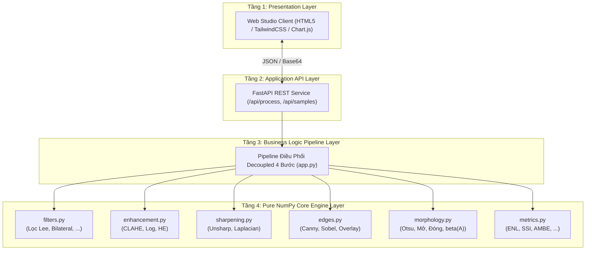
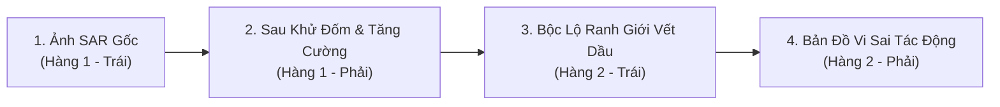

> **Tài liệu lịch sử:** nội dung dưới đây được giữ để tham khảo quá trình phát triển. Thuật toán, số liệu và demo hiện tại được mô tả trong [báo cáo chính](report/BAO_CAO_BTL_XLA.pdf), [README](../README.md) và [đối chiếu hiện tại](management/KIEM_TRA_HIEN_TAI.md). Không dùng các kết luận cũ để xác nhận phiên bản mới.

# CHƯƠNG 3: KIẾN TRÚC HỆ THỐNG & THIẾT KẾ PHẦN MỀM

> **Học phần**: Xử lý ảnh (Digital Image Processing - DIP) — Khoa CNTT, Đại học Giao thông Vận tải (UTC)  
> **Cam kết thiết kế**:
> - **100% Pure NumPy Core Engine**: Không phụ thuộc vào thư viện bao gói cấp cao của OpenCV/SciPy cho các thuật toán xử lý ảnh lõi.
> - **Kiến trúc phân tầng Decoupled**: Tách rời luồng tính toán phân đoạn ranh giới khỏi luồng làm nét hiển thị, triệt tiêu hiện tượng undershoot.
> - **Giao diện Web Studio tương tác thời gian thực**: FastAPI + TailwindCSS tối giản hóa (Minimalism), Canvas 2x2 tầm nhìn lớn.

---

## 3.1. CƠ CẤU TỔ CHỨC THƯ MỤC DỰ ÁN

Mã nguồn được tổ chức theo cấu trúc module hóa phân tầng rõ ràng:

```
D:\Codin\utc-code\HK4_1\XLA\BTL\
├── app.py                              # FastAPI Application Server & REST API Endpoints
├── evaluate_all_edges.py               # Benchmark runner quét FULL 100% dataset (1.853 ảnh)
├── run_experiments.py                  # Kịch bản thực thi chuỗi 5 thử nghiệm khoa học
├── run_app.bat                         # Phím tắt nhấp đúp khởi chạy server và mở trình duyệt
├── requirements.txt                    # Danh sách thư viện tối thiểu (numpy, fastapi, uvicorn, opencv-python)
│
├── src/                                # THƯ VIỆN THUẬT TOÁN PURE NUMPY CORE (Mục 100% tự lập trình)
│   ├── filters.py                      # 9 bộ lọc không gian & khử đốm thích ứng (Lee, Bilateral, Frost, Kuan, ...)
│   ├── enhancement.py                  # Biến đổi Logarit, Global HE, CLAHE cắt ngưỡng & nội suy song tuyến
│   ├── sharpening.py                   # Unsharp Masking, High-Boost, Laplacian, Sobel sharpening
│   ├── edges.py                        # Roberts, Prewitt, Sobel, LoG dò điểm qua 0, Canny 4 bước, Overlay viền
│   ├── morphology.py                   # Otsu, Co, Giãn, Mở, Đóng, Ranh giới hình thái học beta(A), Lọc NASA
│   ├── metrics.py                      # 6 chỉ số định lượng DIP: ENL, SSI, RMS Contrast, Entropy, AMBE, EPI
│   ├── utils.py                        # Đọc/ghi ảnh, bản đồ vi sai |Diff| x 2, cắt lát ngang Profile Slice
│   └── verification.py                 # Bộ kiểm chuẩn 5 ví dụ số tính tay 8x8 & đối chuẩn OpenCV
│
├── static/                             # GIAO DIỆN WEB STUDIO PHONG CÁCH TỐI GIẢN
│   ├── index.html                      # Single-page interface: Canvas 2x2, Lightbox modal, NASA stats
│   ├── css/style.css                   # Custom animation, range slider, modal backdrop
│   └── js/app.js                       # Tương tác Client: Fetch API, Chart.js (Histogram & Profile Slice), Zoom
│
├── data/                               # BỘ DỮ LIỆU SAR THỰC TẾ
│   ├── sample/oil_slicks/              # 5 ảnh SAR có vết dầu lớn, độ tương phản cao (sigma = 23..61)
│   └── sample/sea_surface/             # 5 ảnh biển sạch/vùng biển lặng (Look-alikes)
│
├── kaggle/data/Class_1/                # 1.843 ảnh SAR vết dầu thực tế từ Sentinel-1 (NASA/ESA)
│
├── results/                            # KẾT QUẢ THỰC NGHIỆM ĐỊNH LƯỢNG KHOA HỌC
│   ├── tables/                         # Bảng dữ liệu CSV các thử nghiệm định lượng 1..5
│   ├── figures/                        # Biểu đồ khoa học (CLAHE curves, Profile slices, Canny vs beta(A))
│   └── edge_evaluation_output/         # Báo cáo quét 100% dataset: CSV & 732 ảnh chẩn đoán 4 khung hình
│
└── docs/                               # HỆ THỐNG TÀI LIỆU HỌC THUẬT TOÀN DIỆN
    ├── 01_TONG_QUAN_DE_TAI.md
    ├── 02_CO_SO_LY_THUYET_TOAN_HOC.md
    ├── 03_KIEN_TRUC_HE_THONG_VA_CAI_DAT.md
    ├── 04_KET_QUA_THUC_NGHIEM_VA_DANH_GIA.md
    ├── 05_HUONG_DAN_CAI_DAT_VA_SU_DUNG.md
    ├── 06_BO_CAU_HOI_PHAN_BIEN_BAO_VE_BTL.md
    └── THUAT_TOAN_SU_DUNG.md
```

---

## 3.2. THIẾT KẾ KIẾN TRÚC PHÂN TẦNG (LAYERED ARCHITECTURE)

Hệ thống được thiết kế theo 4 tầng độc lập, đảm bảo nguyên tắc phân tách trách nhiệm (Separation of Concerns):



---

## 3.3. QUY TRÌNH XỬ LÝ 4 BƯỚC CHUẨN Z-PATTERN (PIPELINE DESIGN)

Để tối ưu hóa trải nghiệm thị giác cho giảng viên và người dùng, 4 khung hình hiển thị trên giao diện được sắp xếp theo đúng thứ tự logic tự nhiên (Z-Pattern Workflow):



### Chi tiết kỹ thuật từng bước:
1. **Bước 1 — Ảnh SAR Gốc (Input)**:
   - Ảnh vi ba Sentinel-1 kích thước chuẩn $400 \times 400$ pixel, mang đặc tính nhiễu đốm nhân hạt tiêu và dải xám co cụm.
2. **Bước 2 — Sau Khử Đốm & Tăng Cường (Preprocessed)**:
   - Áp dụng chuỗi: `Lọc Lee MMSE 5x5` (san phẳng phương sai trong lòng dầu và ngoài biển) $\rightarrow$ `CLAHE 8x8` (kéo dãn dải tương phản biển-dầu, tạo histogram 2 đỉnh).
   - Biến lưu trữ: `enhanced_img`.
3. **Bước 3 — Bộc Lộ Ranh Giới Vết Dầu (Segmentation & Boundary Highlight)**:
   - **Tách luồng (Decoupling)**: Thuật toán `detect_oil_slick_morphological` được kích hoạt trực tiếp trên `enhanced_img` (chưa làm nét).
   - Quy trình: `Otsu` $\rightarrow$ `Opening 5x5` $\rightarrow$ `Closing 7x7` $\rightarrow$ `Lọc Area >= 300px & CR >= 0.10` $\rightarrow$ `Ranh giới beta(A) = A - (A co B_3x3)`.
   - Phủ đường bao $\beta(A)$ màu đỏ rực `[255, 30, 30]` lên ảnh làm nét nhẹ `proc_img` bằng thuật toán Alpha-blending.
4. **Bước 4 — Bản Đồ Vi Sai Tác Động (Difference Map)**:
   - Tính toán độ lệch mức xám tuyệt đối giữa ảnh sau xử lý và ảnh gốc:
     $$\text{Diff}(x, y) = \text{clip}(2 \times |I_{\text{processed}}(x, y) - I_{\text{raw}}(x, y)|, 0, 255)$$
   - Thể hiện rõ các vùng sáng: nơi thuật toán đã can thiệp mạnh nhất (dập tắt nhiễu đốm và làm rõ bờ mảng dầu).

---

## 3.4. GIẢI PHÁP KIẾN TRÚC DECOUPLING TRIỆT TIÊU HIỆN TƯỢNG ĐEN ẢNH

Trong xử lý ảnh số, bước làm nét (Unsharp Masking) tạo ra hiệu ứng **Undershoot Dip** ($f - f_{\text{blur}} < 0$) tại các thung lũng sóng biển ngoài khơi, dìm các điểm này xuống màu tối sẫm.

### Nguy cơ nếu không Decouple:
Nếu chạy phân đoạn Otsu trên ảnh đã Unsharp, thuật toán sẽ bắt nhầm các điểm đen do undershoot sóng biển gây ra, dẫn đến:
- Đường biên bị gồ ghề, răng cưa.
- Sinh ra các vùng ứng viên giả ngoài biển khơi.

### Thiết kế Decoupling trong `app.py`:
```python
# 1. Khử đốm Lee MMSE
proc_img = custom_lee_filter(proc_img, window_size=k_size, num_looks=req.num_looks)

# 2. Tăng cường tương phản CLAHE
proc_img = custom_clahe(proc_img, clip_limit=req.clip_limit, tile_grid_size=(grid_dim, grid_dim))

# LƯU BẢN SAO CHO PHÂN ĐOẠN HÌNH THÁI HỌC (CHƯA LÀM NÉT)
enhanced_img = proc_img.copy()

# 3. Làm nét Unsharp Masking để phục vụ thị giác con người
proc_img = unsharp_masking(proc_img, k=req.sharp_k, window_size=5)

# 4. Phân đoạn ranh giới trên enhanced_img (Ổn định tuyệt đối, không méo sóng biển)
morph_res = detect_oil_slick_morphological(
    enhanced_img,
    min_area=req.min_area,
    min_contrast=req.min_contrast,
    manual_threshold=req.manual_threshold,
)
binary_edges = morph_res["boundary_mask"]

# 5. Phủ đường bao beta(A) lên ảnh proc_img (đã làm nét) để mắt người nhìn sắc sảo nhất
edge_visual = overlay_edges(proc_img, binary_edges, color=color_rgb, alpha=0.9)
```

Kết quả: **Đường biên $\beta(A)$ đạt độ tinh khiết toán học cao nhất**, đồng thời **ảnh hiển thị cho mắt người đạt độ sắc nét tối đa**.

---

## 3.5. THIẾT KẾ GIAO DIỆN WEB STUDIO (UI/UX MINIMALISM)

Giao diện được thiết kế theo trường phái **Tối giản kỹ thuật cao (Technical Minimalism)**:
1. **Lưới 2x2 Canvas lớn**: Chiều cao ảnh từ $380\text{px} \dots 420\text{px}$, diện tích hiển thị tăng gấp $2.5$ lần so với bố cục cũ.
2. **Modal Lightbox Fullscreen**: Người dùng có thể nhấp chuột vào bất kỳ ô ảnh nào để xem phóng to chi tiết từng pixel ở độ phân giải gốc.
3. **Panel Thống Kê Đặc Trưng Vết Dầu Nền Đơn Sắc (Single Solid)**:
   - Loại bỏ các hiệu ứng nhấp nháy rối mắt.
   - Sử dụng nền trắng phẳng (`bg-white border border-slate-200`) với các ô chỉ số nền xám nhạt (`bg-slate-50`).
   - Các chữ số đo lường (Số vết dầu $N$, Diện tích px, Tỷ số tương phản $C_R$, Khả tách $\eta$) hiển thị ở kích cỡ cực lớn: `text-3xl font-black font-mono text-slate-900`.
4. **Trực quan hóa thời gian thực bằng Chart.js**:
   - Biểu đồ lược đồ độ xám Histogram (256 bins) so sánh trước/sau xử lý.
   - Biểu đồ lát cắt ngang Profile Slice (Hàng $y = 200$) chứng minh độ dốc biên và sự phẳng mịn của sóng biển.
