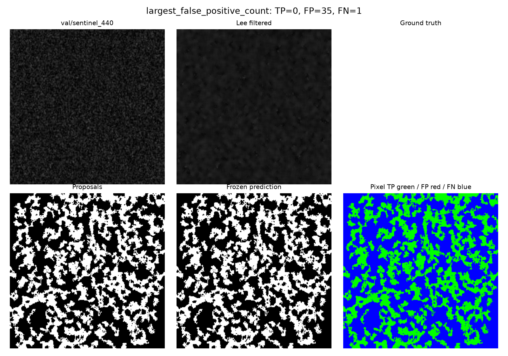
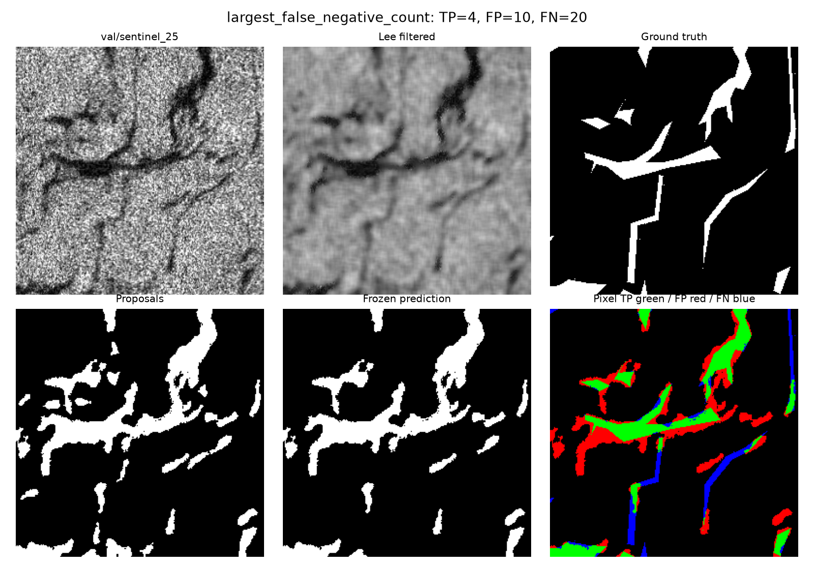
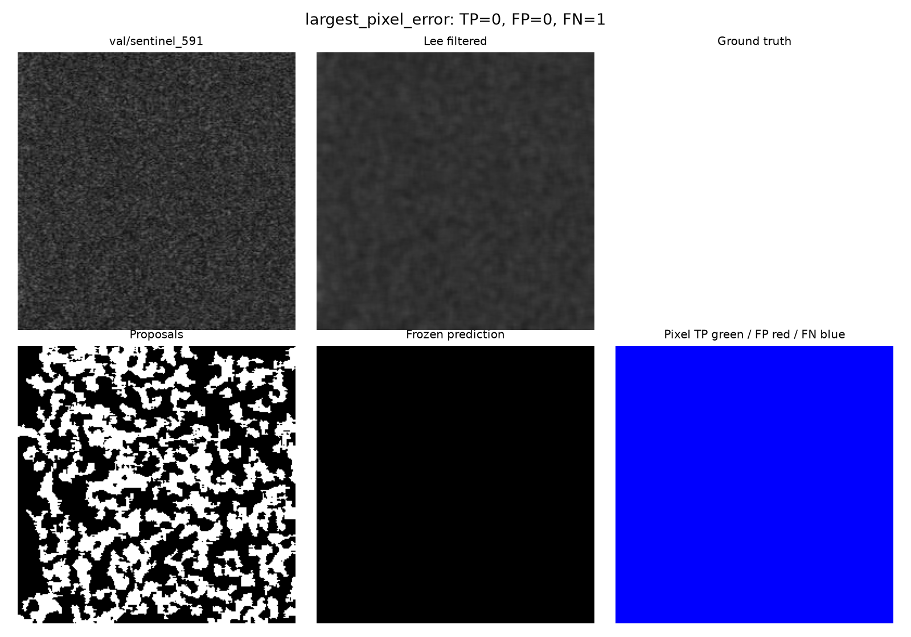

# Thống kê và ba trường hợp thất bại

Phân tích mô tả sau lựa chọn, không dùng để đổi cấu hình. Tái tạo: `python scripts/analyze_failures.py`.

Micro cộng TP/FP/FN trước khi chia. Macro là trung bình từng ảnh có mẫu số xác định; báo rõ số ảnh bị loại do chỉ số không xác định. Độ lệch chuẩn là độ phân tán giữa các patch (ddof=0), không phải sai số giữa các lần huấn luyện hay khoảng tin cậy theo cảnh.

| Thí nghiệm | F1 micro | F1 từng ảnh: mean ± SD | Số ảnh xác định / không xác định |
|---|---:|---:|---:|
| test_final | 0.28052 | 0.34912 ± 0.31728 | 814 / 25 |
| test_baseline | 0.01614 | 0.02892 ± 0.06291 | 839 / 0 |
| test_no_classifier | 0.12195 | 0.22920 ± 0.25403 | 839 / 0 |
| palsar_val | 0.37235 | 0.41206 ± 0.31167 | 734 / 42 |
| validation_label64 | 0.34533 | 0.42255 ± 0.34849 | 647 / 24 |
| validation_label128 | 0.34031 | 0.42184 ± 0.34856 | 646 / 25 |
| validation_label192 | 0.33706 | 0.42027 ± 0.34938 | 646 / 25 |

Thời gian trong JSON là số đo từng worker từ lần chạy đã lưu, có thể chịu tranh chấp CPU; không coi là benchmark độ trễ tuần tự.

## val/sentinel_440 — largest_false_positive_count

Trước classifier: TP/FP/FN=0/35/1; sau classifier: 0/35/1.
Có 39401 pixel dầu GT không có trong ứng viên; classifier loại thêm 0 pixel dầu GT.
Đây là bằng chứng vị trí mất thông tin theo từng bước. Classifier chỉ loại vùng, không thể khôi phục pixel thiếu hoặc sửa đường biên. FP mức đối tượng là vùng không ghép được với GT ở IoU≥0,5: có thể do phân mảnh một vùng dầu thật, không nhất thiết là pixel nền bị gọi nhầm dầu. Không thể quy lỗi cụ thể cho mưa, gió yếu hay màng sinh học vì SOS không có nhãn phụ này.

## val/sentinel_25 — largest_false_negative_count

Trước classifier: TP/FP/FN=4/22/20; sau classifier: 4/10/20.
Có 1367 pixel dầu GT không có trong ứng viên; classifier loại thêm 342 pixel dầu GT.
Đây là bằng chứng vị trí mất thông tin theo từng bước. Classifier chỉ loại vùng, không thể khôi phục pixel thiếu hoặc sửa đường biên. FP mức đối tượng là vùng không ghép được với GT ở IoU≥0,5: có thể do phân mảnh một vùng dầu thật, không nhất thiết là pixel nền bị gọi nhầm dầu. Không thể quy lỗi cụ thể cho mưa, gió yếu hay màng sinh học vì SOS không có nhãn phụ này.

## val/sentinel_591 — largest_pixel_error

Trước classifier: TP/FP/FN=0/40/1; sau classifier: 0/0/1.
Có 38359 pixel dầu GT không có trong ứng viên; classifier loại thêm 27177 pixel dầu GT.
Đây là bằng chứng vị trí mất thông tin theo từng bước. Classifier chỉ loại vùng, không thể khôi phục pixel thiếu hoặc sửa đường biên. FP mức đối tượng là vùng không ghép được với GT ở IoU≥0,5: có thể do phân mảnh một vùng dầu thật, không nhất thiết là pixel nền bị gọi nhầm dầu. Không thể quy lỗi cụ thể cho mưa, gió yếu hay màng sinh học vì SOS không có nhãn phụ này.

Hướng kiểm tra tiếp: khảo sát ngưỡng thích nghi để cải thiện vùng ứng viên và recall đối tượng nhỏ; kiểm tra phân tách vùng dính; bổ sung nhãn look-alike độc lập. Các thay đổi cần validation và tập kiểm tra mới, không tối ưu theo ba ảnh này.
