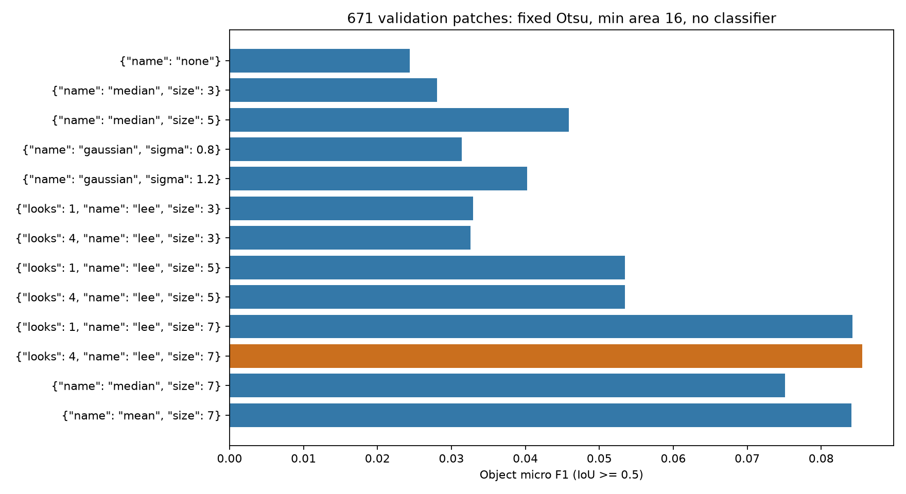

# Bằng chứng lựa chọn thuật toán và bộ lọc Lee

Tái tạo: `python scripts/explain_selection.py --workers 6`. Code chạy **13 cấu hình lọc trên toàn bộ 671 ảnh validation**, giữ Otsu, morphology none và min_area16 giống nhau. 11 cấu hình gốc được assert khớp kết quả trước; mean7 và median7 là hai đối chứng bổ sung sau lựa chọn để kiểm tra ảnh hưởng cửa sổ 7×7. Hai phép lọc bổ sung còn được đối chiếu NumPy/reference trên toàn bộ 671 ảnh. File `per_image.json` lưu TP/FP/FN cùng các số đếm và sai số cho từng ảnh/từng bộ lọc; `evidence.json` lưu tổng hợp, hash nguồn, quy tắc chọn và khoảng bootstrap. Không đọc ảnh test, không thay mô hình đã khóa.

## Vì sao đưa Lee vào khảo sát?

Đây là giả thuyết để thử, không phải kết luận trước thực nghiệm. Trong biến thể đang cài, với trung bình cục bộ m, phương sai v và tham số L:

`noise = m²/L; w = max(v−noise,0)/max(v,1e−12); output = m + w·(input−m)`.

Nếu phương sai cục bộ không vượt mức noise ước lượng, w=0 và đầu ra là trung bình cục bộ. Khi v lớn hơn, đầu ra giữ lại một phần sai lệch so với trung bình. Cơ chế điều chỉnh theo thống kê cục bộ là lý do đáng khảo sát cùng median/Gaussian. Nó **không bảo đảm giữ đúng biên dầu hoặc tăng F1**. Đây là biến thể công thức trong `core.filter_image`, không tuyên bố mọi biến thể Lee giống nhau. PNG SOS chưa được xác nhận là sigma0 tuyến tính, nên L=4 là tham số thử nghiệm, không phải số looks vật lý được xác minh.

## So sánh có kiểm soát: chỉ thay bộ lọc

| Bộ lọc | TP | FP | FN | Precision | Recall | F1 | Pixel IoU | ΔF1 Lee7,L4 − bộ lọc | Khoảng bootstrap 95% của Δ |
|---|---:|---:|---:|---:|---:|---:|---:|---:|---|
| `{'name': 'none'}` | 518 | 39283 | 2222 | 0.01301 | 0.18905 | 0.02435 | 0.42715 | +0.06117 | [+0.05337, +0.06934] |
| `{'name': 'median', 'size': 3}` | 758 | 50479 | 1982 | 0.01479 | 0.27664 | 0.02809 | 0.47805 | +0.05743 | [+0.05075, +0.06452] |
| `{'name': 'median', 'size': 5}` | 910 | 36046 | 1830 | 0.02462 | 0.33212 | 0.04585 | 0.52406 | +0.03967 | [+0.03460, +0.04509] |
| `{'name': 'gaussian', 'sigma': 0.8}` | 794 | 47039 | 1946 | 0.01660 | 0.28978 | 0.03140 | 0.48487 | +0.05412 | [+0.04765, +0.06078] |
| `{'name': 'gaussian', 'sigma': 1.2}` | 895 | 40877 | 1845 | 0.02143 | 0.32664 | 0.04021 | 0.51178 | +0.04531 | [+0.03978, +0.05131] |
| `{'name': 'lee', 'size': 3, 'looks': 1}` | 821 | 46341 | 1919 | 0.01741 | 0.29964 | 0.03290 | 0.49093 | +0.05262 | [+0.04624, +0.05917] |
| `{'name': 'lee', 'size': 3, 'looks': 4}` | 822 | 46897 | 1918 | 0.01723 | 0.30000 | 0.03258 | 0.49069 | +0.05294 | [+0.04659, +0.05949] |
| `{'name': 'lee', 'size': 5, 'looks': 1}` | 961 | 32247 | 1779 | 0.02894 | 0.35073 | 0.05347 | 0.53646 | +0.03205 | [+0.02777, +0.03671] |
| `{'name': 'lee', 'size': 5, 'looks': 4}` | 967 | 32486 | 1773 | 0.02891 | 0.35292 | 0.05344 | 0.53553 | +0.03209 | [+0.02811, +0.03662] |
| `{'name': 'lee', 'size': 7, 'looks': 1}` | 1034 | 20770 | 1706 | 0.04742 | 0.37737 | 0.08426 | 0.56455 | +0.00126 | [-0.00044, +0.00313] |
| `{'name': 'lee', 'size': 7, 'looks': 4}` | 1049 | 20743 | 1691 | 0.04814 | 0.38285 | 0.08552 | 0.56293 | +0.00000 | [+0.00000, +0.00000] |
| `{'name': 'median', 'size': 7}` | 999 | 22856 | 1741 | 0.04188 | 0.36460 | 0.07513 | 0.55572 | +0.01039 | [+0.00754, +0.01342] |
| `{'name': 'mean', 'size': 7}` | 1033 | 20787 | 1707 | 0.04734 | 0.37701 | 0.08412 | 0.56463 | +0.00140 | [-0.00031, +0.00327] |

Khoảng trên dùng 2000 lần lấy mẫu lại **cùng chỉ số patch** cho các bộ lọc, tính micro F1 từ tổng TP/FP/FN mỗi lần. Đây là phân tích thăm dò sau khi đã xem validation, chưa hiệu chỉnh nhiều so sánh và không bảo đảm độc lập theo cảnh. Không coi khoảng này là chứng minh ưu thế phổ quát.

Đối chứng bổ sung cùng cửa sổ 7×7 (không thuộc grid chọn mô hình ban đầu):

- `{'name': 'median', 'size': 7}`: F1=0.075127, ΔF1 so với Lee7,L4=-0.010394.
- `{'name': 'mean', 'size': 7}`: F1=0.084121, ΔF1 so với Lee7,L4=-0.001400.

Lee7,L4 − Lee7,L1 có khoảng bootstrap [-0.000439, +0.003129]. Khoảng chứa 0: chưa có bằng chứng rõ ràng L=4 tốt hơn L=1 trong phân tích này.

## Kết quả tốt nhất mỗi họ trong 110 cấu hình

| Họ | Số cấu hình đã thử | Cấu hình đạt F1 lớn nhất | F1 | Recall |
|---|---:|---|---:|---:|
| none | 10 | `{'filter': {'name': 'none'}, 'threshold': {'name': 'otsu'}, 'morphology': {'operation': 'none', 'min_area': 16}}` | 0.02435 | 0.18905 |
| median | 20 | `{'filter': {'name': 'median', 'size': 5}, 'threshold': {'name': 'otsu'}, 'morphology': {'operation': 'none', 'min_area': 16}}` | 0.04585 | 0.33212 |
| gaussian | 20 | `{'filter': {'name': 'gaussian', 'sigma': 1.2}, 'threshold': {'name': 'otsu'}, 'morphology': {'operation': 'none', 'min_area': 16}}` | 0.04021 | 0.32664 |
| lee | 60 | `{'filter': {'name': 'lee', 'size': 7, 'looks': 4}, 'threshold': {'name': 'otsu'}, 'morphology': {'operation': 'none', 'min_area': 16}}` | 0.08552 | 0.38285 |

Lee được thử nhiều cấu hình hơn các họ khác; bảng lấy cực đại này có lợi thế do kích thước grid. Bảng giữ cố định Otsu phía trên giúp tách bớt ảnh hưởng ngưỡng, nhưng vẫn chỉ đánh giá giai đoạn tạo ứng viên. Chưa thử mọi bộ lọc kết hợp mọi classifier, nên không thể kết luận Lee luôn tốt nhất cho pipeline cuối.

## Quy tắc lựa chọn cuối có gì mang tính chủ quan?

Đã chạy 110 cấu hình tạo ứng viên; giữ 3 cấu hình theo F1-band/Recall/runtime, rồi chạy 729 tổ hợp hình thái/diện tích/đặc trưng/classifier. Đây là tìm kiếm theo giai đoạn, không phải exhaustive search toàn bộ không gian. Ngưỡng F1-band **0,005 là quy ước**, không phải định lý hoặc khoảng tương đương thống kê.

Nếu chỉ tối đa F1, cấu hình thắng là `{'filter': {'name': 'lee', 'size': 7, 'looks': 1}, 'threshold': {'name': 'otsu'}, 'morphology': {'operation': 'none', 'min_area': 64}}`, `svm {'C': 10}`, F1=0.343452, Recall=0.367518. Cấu hình đã chọn có F1=0.340312, Recall=0.370803.

| Thứ tự theo quy tắc đã dùng | Lọc | Nhóm | Classifier | F1 | Recall | Thời gian ghi nhận (s) |
|---:|---|---|---|---:|---:|---:|
| 1 | `{'name': 'lee', 'size': 7, 'looks': 4}` | all | `svm {'C': 10}` | 0.340312 | 0.370803 | 0.149947 |
| 2 | `{'name': 'lee', 'size': 7, 'looks': 4}` | all | `svm {'C': 1}` | 0.340312 | 0.370803 | 0.165671 |
| 3 | `{'name': 'lee', 'size': 7, 'looks': 4}` | all | `svm {'C': 0.1}` | 0.340426 | 0.370803 | 0.186799 |
| 4 | `{'name': 'lee', 'size': 7, 'looks': 1}` | all | `svm {'C': 1}` | 0.343393 | 0.367518 | 0.150850 |
| 5 | `{'name': 'lee', 'size': 7, 'looks': 1}` | all | `svm {'C': 10}` | 0.343452 | 0.367518 | 0.155449 |
| 6 | `{'name': 'lee', 'size': 7, 'looks': 1}` | all | `svm {'C': 0.1}` | 0.343334 | 0.367518 | 0.179438 |
| 7 | `{'name': 'lee', 'size': 7, 'looks': 4}` | intensity | `svm {'C': 10}` | 0.337943 | 0.365693 | 0.131158 |
| 8 | `{'name': 'lee', 'size': 7, 'looks': 4}` | intensity | `svm {'C': 1}` | 0.337943 | 0.365693 | 0.146216 |
| 9 | `{'name': 'lee', 'size': 7, 'looks': 4}` | intensity | `svm {'C': 0.1}` | 0.337719 | 0.365328 | 0.161844 |
| 10 | `{'name': 'lee', 'size': 7, 'looks': 1}` | all | `svm {'C': 10}` | 0.338776 | 0.363504 | 0.155453 |

C=10 và C=1 ở cấu hình đã chọn có cùng Recall/F1; C=10 đứng trước nhờ thời gian một lần thấp hơn. Thời gian gồm wrapper fit/evaluate và phụ thuộc tải máy; **chưa đủ chứng cứ khẳng định C=10 tốt hơn C=1**. Không thay cấu hình sau khi đã xem test. Nếu đổi tiêu chí lựa chọn hoặc mở rộng grid cần công bố một thực nghiệm mới và không gọi test đã dùng là tập hoàn toàn chưa xem.

## Đối chiếu NumPy không thay cho đánh giá chất lượng

`../verification_real.json` lưu sai số thực tế của từng phép toán trên 8 ảnh validation; `../model_comparison.json` lưu agreement, objective và hội tụ của classifier. Lee reference sử dụng thống kê SciPy ghép cùng công thức, **không phải API Lee độc lập**. Sai số nhỏ chứng minh hai triển khai gần nhau trong ca kiểm tra, không chứng minh phát hiện dầu tốt. Chất lượng phát hiện phải đọc TP/FP/FN so với mask SOS.

## Kết luận được phép đưa vào báo cáo

Trong grid ban đầu và split SOS đã khảo sát, Lee7,L4 + Otsu có F1 tạo ứng viên cao nhất, nên được đưa vào giai đoạn phân lớp. Các đối chứng mean7/median7 là khảo sát bổ sung, không được dùng để thay đổi mô hình sau khi đã xem test. Quy tắc có ưu tiên Recall dẫn đến cấu hình cuối đã công bố. Không có định lý bảo đảm đây là bộ lọc tốt nhất cho mọi ảnh SAR; chưa chứng minh tối ưu toàn cục hoặc khả năng triển khai trên biển Việt Nam. Otsu là ngưỡng toàn cục; Niblack thích nghi đã khảo sát nhưng không được chọn làm mặc định. Các giới hạn góc tới/gió/look-alike vẫn còn.
